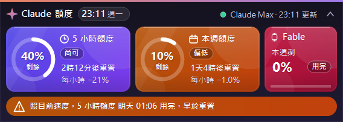
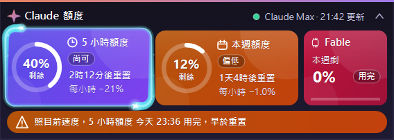
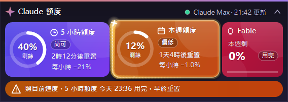
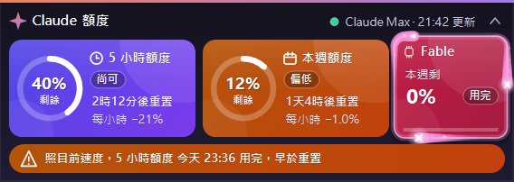
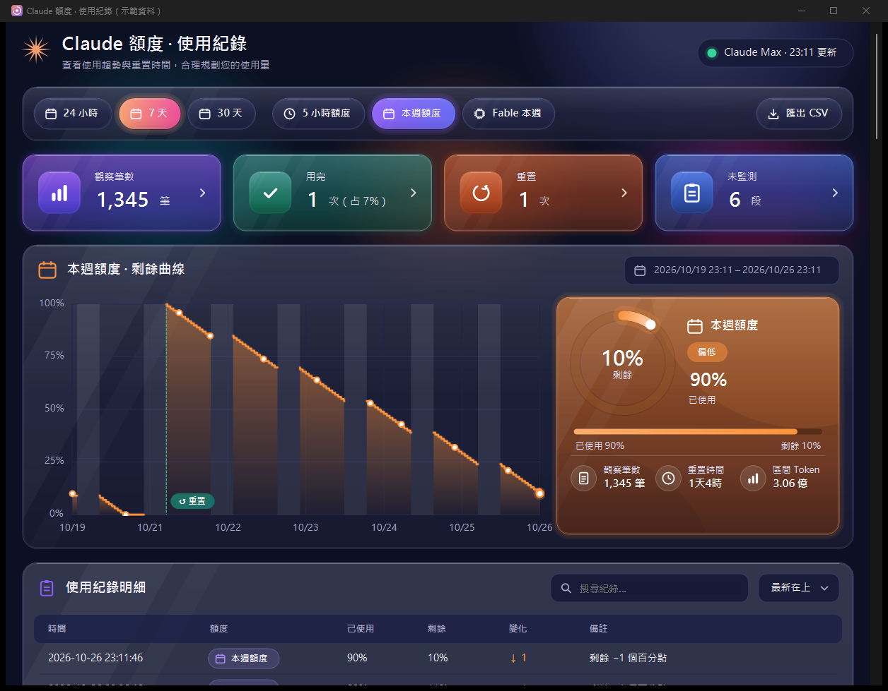
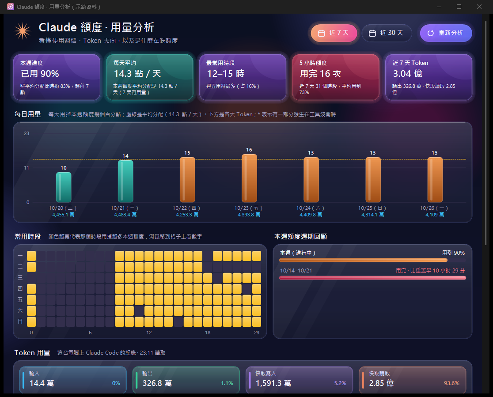
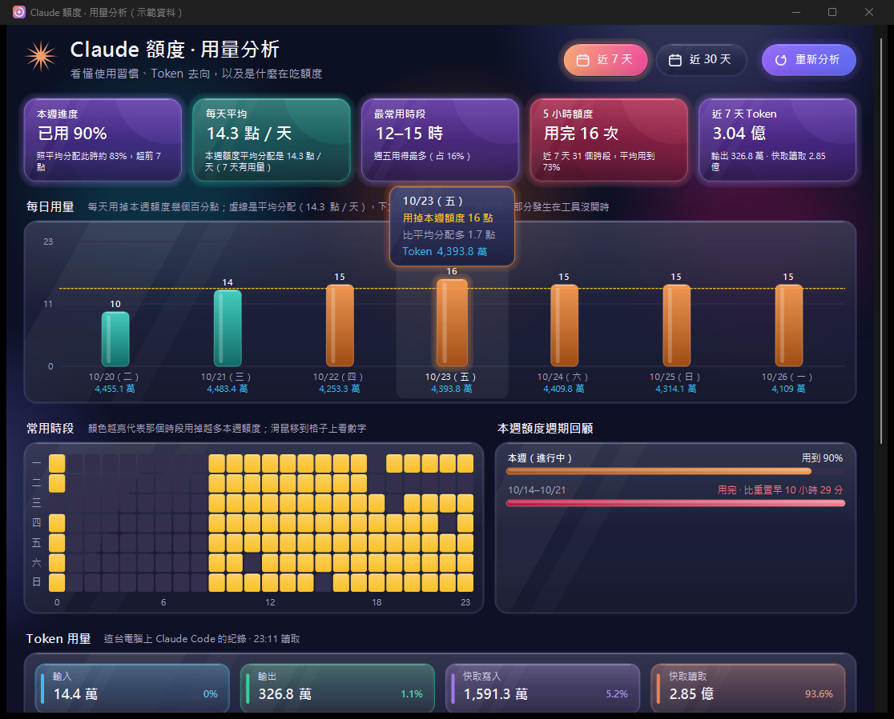
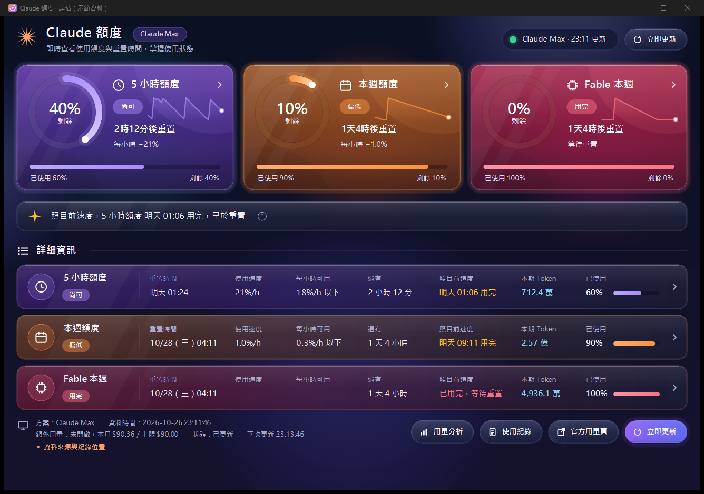
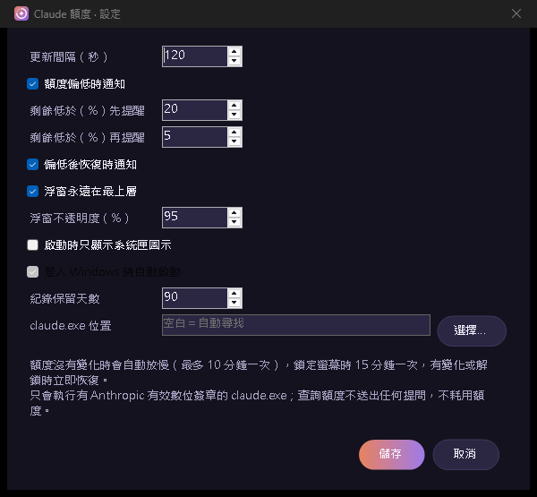

# ClaudeUsageMonitor｜Claude 額度小幫手

在 Windows 或 Mac 桌面放一個小浮窗，隨時看 **Claude 訂閱方案的 5 小時額度、每週額度、各模型每週額度還剩多少、什麼時候重置、照目前速度會不會在重置前用完**。工具開著時會累積使用曲線，可匯出 CSV。

這是**非官方工具**，不是 Anthropic 的產品，也未受其背書。不會幫你增加額度，也不會替你送出任何提問。設計參考 [hayabusasean/CodexUsageMonitor](https://github.com/hayabusasean/CodexUsageMonitor)（MIT），是它的 Claude 版本。

## 適合誰

- Windows 10／11（64 位元），或 **macOS 14 Sonoma 以上**（Apple Silicon 與 Intel 各有一個版本，見下方「Mac 版」）。
- 電腦上已安裝**官方 Claude Code**（Windows：原生安裝程式或 WinGet 版的 `claude.exe`；Mac：官方安裝程式或 Homebrew 版的 `claude`），而且用 **Claude Pro／Max／Team 訂閱帳號登入**。
- 只用 API 金鑰、Bedrock、Vertex 等登入方式沒有「方案額度」，本工具會顯示原因後停止查詢。
- 只在瀏覽器登入 claude.ai 不夠；本工具是透過電腦上的 Claude Code 查詢。

## 畫面

以下截圖都是用 `--screenshot` 的示範資料產生，不是真實帳號。

**標準浮窗**：標題旁是現在時間與星期，左兩塊是 5 小時與本週額度，右側小卡是各模型的本週額度，底部一句話講結論。



**小動畫**：額度重置時噴紙屑並浮出「+60% 已恢復」、用掉額度時浮出「−1%」、滑鼠指到的卡片會浮起。


**滑鼠移到卡片**：每個額度有自己的光芒沿著卡片邊緣繞行——5 小時是青藍電光（兩道、最快）、本週是金色流光（一道長尾）、各模型是粉紫星光（三道）；光頭有閃爍星芒與殘留小星星，移開後淡出才停止。







**精簡浮窗**：只顯示比較緊的那個額度，右側顯示現在時間。


**使用紀錄**：期間與額度切換、4 張統計卡（觀察筆數、用完、重置、未監測）、剩餘曲線（滑鼠指上去看當時數值）與摘要卡（含區間 Token）、可搜尋與排序的明細。



**額度詳情**（深色玻璃儀表板）：每個額度一張玻璃卡（發光圓環、狀態、倒數、使用速度、走勢、已使用／剩餘），下方每列列出重置時間、使用速度、每小時可用、還有多久、照目前速度、本期 Token；點卡片或列可跳到該額度的使用紀錄；資料來源預設收起。開啟時卡片依序浮起、圓環轉入、數字跳到目前值、走勢線畫出、各列從右側滑入；滑鼠移到卡片或列上會浮起並有一道反光掃過，查詢中「立即更新」的圖示與標題星芒會轉動。

**用量分析**（右鍵選單或詳情裡的「用量分析」）：本週進度是否超前、每天平均用量、最常用的時段、5 小時額度用完幾次、區間 Token 數；每日用量圖（含當天 Token）、一週時段熱力圖、本週額度週期回顧、Token 分類（輸入／輸出／快取寫入／快取讀取）與各模型占比，以及 Claude Code 自己分析「是什麼在吃額度」（長對話、排程任務、大量子代理…附說明與建議，和 `/usage` 同一份資料）。期間切換與「重新分析」在頁首；各區塊捲進畫面時才進場（卡片彈入、長條依序長高、熱力圖由左上波浪展開、Token 數字往上跳），滑鼠指到每日長條或熱力圖格子會浮出玻璃提示框顯示當天／當時段的數字；分析中標題星芒會轉動。







**設定**



## 安裝、更新與移除

| 項目 | 說明 |
| --- | --- |
| 版本 | 0.4.0（詳情與用量分析加入進場與懸停動畫、全面玻璃質感、浮窗顯示時間。0.3.0 深色玻璃儀表板、0.2.0 用量分析與 Token、0.1.1 卡片光芒、0.1.0 第一版） |
| 安裝 | 解壓縮 `ClaudeUsageMonitor-v0.4.0-win-x64.zip` 到固定資料夾（例如 `D:\工具\ClaudeUsageMonitor`），雙擊 `ClaudeUsageMonitor.exe`。可對照同名 `.sha256` 檔核對 SHA-256。 |
| 開機自動啟動 | 設定 →「登入 Windows 時自動啟動」（寫入目前使用者的啟動項目，不需要系統管理員）。 |
| 更新 | 先從選單「離開」，用新版 exe 覆蓋舊檔再開啟。設定與紀錄存在 `%LOCALAPPDATA%\ClaudeUsageMonitor`，不在 exe 旁邊，更新不會動到。 |
| 移除 | 先在設定取消開機自動啟動、從選單「離開」，再刪除程式資料夾；要連紀錄一起刪就刪 `%LOCALAPPDATA%\ClaudeUsageMonitor`。 |

## Mac 版

畫面、顏色、動畫與功能都和 Windows 版相同；系統匣數字改在螢幕上方的**選單列**，不會出現在 Dock。

| 項目 | 說明 |
| --- | --- |
| 下載哪一個 | 蘋果選單 →「關於這台 Mac」：晶片寫 Apple M1／M2／M3／M4… 用 `ClaudeUsageMonitor-v0.4.0-macos-arm64.zip`；寫 Intel 用 `…-macos-x64.zip`。可對照 `.sha256` 檔核對。 |
| 安裝 | 連按兩下 zip 解壓縮，把 `ClaudeUsageMonitor.app` 拖到「應用程式」資料夾。 |
| 第一次開啟 | 這個 App 沒有 Apple 開發者簽署，第一次開會被擋。到「系統設定 → 隱私權與安全性」往下找到 ClaudeUsageMonitor，按「強制打開／仍要打開」，之後就能正常開。也可以在「終端機」貼上 `xattr -dr com.apple.quarantine /Applications/ClaudeUsageMonitor.app` 後再開。 |
| 開啟後 | 選單列出現彩色數字圖示，浮窗在螢幕右上角。在浮窗按右鍵（或按住 Control 點一下）開選單；點選單列圖示也有同樣的選單。 |
| 開機自動啟動 | 設定 →「登入時自動啟動」（寫入 `~/Library/LaunchAgents`，macOS 會顯示「已新增背景項目」）。 |
| 資料位置 | `~/Library/Application Support/ClaudeUsageMonitor`。 |
| 通知 | 透過 macOS 通知中心；來源會顯示為「指令碼編寫程式」，第一次可能要在「系統設定 → 通知」允許。 |
| claude 簽章 | 會用 macOS 的 `codesign` 確認 claude 是 Anthropic 簽署的。有使用者回報 macOS 26 上部分版本的完整性檢查會失敗；這時只要簽章仍標示 Anthropic 的開發者編號就照常使用，並在「額度詳情」顯示一行警告。 |
| 移除 | 先在設定取消「登入時自動啟動」，從選單「離開」，再把 App 丟到垃圾桶；要連紀錄一起刪就刪上面的資料位置。 |

排錯：在「終端機」執行 `/Applications/ClaudeUsageMonitor.app/Contents/MacOS/ClaudeUsageMonitor --probe ~/Desktop/claude-probe.json`，會實際查詢一次並把結果寫到桌面（不含 email，只有額度與錯誤代碼）。

## 怎麼用

1. 解壓縮後雙擊 `ClaudeUsageMonitor.exe`（不需要另裝 .NET，也不需要系統管理員權限）。
2. 浮窗預設出現在螢幕右下角，約每 2 分鐘更新一次（設定可改 60～900 秒）。額度連續沒有變化時會自動放慢（最多 10 分鐘一次），鎖定螢幕時 15 分鐘一次；一偵測到 Claude Code 有動作、解鎖或從睡眠醒來就立即更新。
3. 在浮窗或右下角系統匣圖示上**按右鍵**開選單：立即更新、切換精簡／標準、使用紀錄、額度詳情、設定、官方用量頁、開啟資料夾、離開。
4. 浮窗可拖曳；雙擊開額度詳情；右下角的 ⌃／⌄ 切換標準與精簡模式；點系統匣圖示可顯示／隱藏浮窗。
5. 要真正停止記錄，請從選單選「離開」。

每個額度是一塊彩色卡片，**不用讀數字也看得出狀況**：

| 卡片顏色 | 標籤 | 意思 |
| --- | --- | --- |
| 綠 | 充足 | 剩一半以上 |
| 紫 | 尚可 | 剩 50% 以下 |
| 橘 | 偏低 | 剩餘低於「先提醒」門檻（預設 20%） |
| 紅 | 告急／用完 | 剩餘低於「再提醒」門檻（預設 5%），告急時卡片會緩慢閃動 |

| 畫面上的字 | 意思 |
| --- | --- |
| 圓環與百分比 | **剩餘**額度（圓環越滿剩越多），不是已使用比例。 |
| `2時12分後重置` | 官方回報的重置時間倒數。 |
| `每小時 −1.0%` | 依工具開著時的觀察推估的使用速度。 |
| 底部提示條 | 一句話結論，例如「照目前速度，本週額度 明天 09:27 用完，早於重置」或「額度撐得到重置」。 |
| `速度觀察中…` | 觀察時間太短：需要連續觀察 15 分鐘以上且用掉 2 個百分點，或連續觀察 1 小時。 |
| 右側小卡 | 各模型的每週額度（例如 Fable）。 |
| 標題列圓點 | 綠：剛更新；珊瑚色光暈：查詢中；黃：資料過時；紅：查詢失敗。 |
| 系統匣數字 | 5 小時與本週兩者中**較少**的剩餘百分比，底色同卡片顏色。 |

小動畫（遵循 Windows「動畫效果」設定，關閉時全部停用；沒有動作時不重繪、不耗 CPU）：開啟時圓環從 0 轉到目前值；查詢中星芒旋轉、卡片有掃光；每次更新完星芒彈一下、狀態燈泛出漣漪；額度減少時浮出「−1%」；額度重置時噴出彩色紙屑；滑鼠移到卡片上會浮起並有該額度專屬的光芒沿邊繞行（移開後淡出），點一下有水波紋；紀錄圖表的曲線會畫出來；詳情與用量分析的進場、懸停與提示框動畫見上方「畫面」。浮窗時間每分鐘整點更新一次。

額度詳情視窗的「資料來源與紀錄位置」預設收起，需要時點開。

**提醒**：剩餘低於設定門檻（預設 20%、5%）時，每個重置週期各通知一次；曾經偏低的額度恢復時也會通知。

## 它怎麼取得額度

本工具不讀登入檔、不直接呼叫 Anthropic 的伺服器。每次更新時它會：

1. 找到電腦上的 `claude.exe`，確認它有 **Anthropic, PBC 的有效數位簽章**（沒有就拒絕執行）。
2. 以 Agent SDK 的串流模式短暫啟動它，只送兩個唯讀的控制請求：`initialize`（取得登入帳號與方案）與 `get_usage`（取得方案額度，也就是 Claude Code 裡 `/usage` 的同一份資料），查完立即結束。
3. 啟動時不載入使用者／專案設定（不會跑 hooks、外掛、MCP 伺服器）、不寫入對話紀錄（`--no-session-persistence`），也**不送出任何提問，所以不耗用模型額度**。

每次查詢約 1.5 秒，查完子程序就結束，不常駐。

## 資料與隱私

- 紀錄存在 `%LOCALAPPDATA%\ClaudeUsageMonitor`：`settings.json`（設定）、`history\*.jsonl`（每次觀察的百分比與重置時間）、`last_good.json`、`status.json`（給其他程式讀的目前狀態）、`alerts.json`、`logs\`（只記錯誤代碼）。預設保留 90 天。
- 帳號只以「本機隨機鹽＋email＋組織」的雜湊值區分，**不保存 email**。Claude Code 的錯誤輸出一律丟棄，不寫入紀錄。
- 本工具本身不連網、沒有遙測、不上傳任何資料。連網的是官方 Claude Code（照它平常的方式連到 Anthropic）。
- 為了在你開始使用時立刻更新，工具會監看 `~/.claude/projects` 資料夾**有沒有檔案變動**。
- **Token 數**：開啟用量分析、詳情或使用紀錄時，工具會讀這台電腦上 Claude Code 的對話紀錄（`~/.claude/projects/**/*.jsonl`），**只取每次回應的時間、模型與 Token 數字**，不保存、不顯示、不上傳任何對話內容；同一則回應會依編號去重。只含這台電腦，不含其他裝置與 claude.ai 網頁。
- **是什麼在吃額度**：由 Claude Code 自己掃描本機近 7 天的對話紀錄後回報（約 3～10 秒），工具只保存它回報的比例與名稱（`behaviors.json`）。
- 已知副作用：每次查詢時，Claude Code 會更新它自己 `~/.claude.json` 裡的功能旗標快取時間（`cachedGrowthBookFeaturesAt`），這和平常每次啟動 Claude Code 一樣。
- CSV 匯出含使用時間，分享前請先檢查。

## 限制

- `get_usage` 是 Claude Code 標示為「實驗性」的介面，日後 Claude Code 改版可能改變格式；改變時工具會顯示「回應無法辨識」而不是顯示錯的數字。
- 燒速與「何時用完」是觀察推估，不是官方數字；關機、休眠或工具關閉期間不會補資料（圖上以斜線標示「未監測」）。
- 只支援原生 `claude.exe`（Mac 為原生 `claude`）；如果 Claude Code 是用 npm 安裝的 Node 版本，請在設定指定原生執行檔位置或改用官方安裝程式。
- Mac 版目前只在 Windows 上用同一份程式驗證過畫面與查詢流程，尚未在 Mac 實機確認；App 本身沒有 Apple 開發者簽署。

## 給開發者

```powershell
# 需要 .NET 10 SDK（Mac 版也在 Windows 上建置與打包）
dotnet build src\ClaudeUsageMonitor.csproj        # Windows 版（WinForms）
dotnet build mac\ClaudeUsageMonitor.Mac.csproj    # Mac 版（Avalonia，也能在 Windows 上執行測試）
.\build.ps1                     # Windows：自帶執行環境的單一 exe → dist\ClaudeUsageMonitor-v<版本>-win-x64.zip
.\build-mac.ps1                 # Mac：Apple Silicon 與 Intel 的 .app → dist\ClaudeUsageMonitor-v<版本>-macos-arm64.zip / -x64.zip
```

兩個版本共用 `src\Core`（查詢、解析、紀錄、預估、提醒、白話結論），只有畫面分開：Windows 在 `src\`，Mac 在 `mac\`。

| 參數 | 用途 |
| --- | --- |
| `--demo` | 用合成資料執行（資料放在暫存資料夾），不需要 Claude 帳號 |
| `--probe <檔案.json>` | 實際查詢一次額度與「是什麼在吃額度」，把結果寫到檔案後結束（排錯用，不寫入紀錄） |
| `--probe-tokens <檔案.json> [--days 7]` | 讀本機對話紀錄，輸出區間 Token 數、每天與各模型（排錯用） |
| `--screenshot <資料夾>` | 用示範資料把每個視窗輸出成 PNG 後結束 |
| 環境變數 `CLAUDE_USAGE_MONITOR_HOME` | 改變資料資料夾位置（測試用） |

程式結構：`ClaudeUsageClient`（啟動 claude.exe、控制請求）→ `UsageParser`（解析）→ `MonitorService`（排程、紀錄、提醒）→ `OverlayForm`／`HistoryForm`／`DetailsForm`／`SettingsForm`（畫面）。`tools\make_icon.py` 產生程式圖示。
